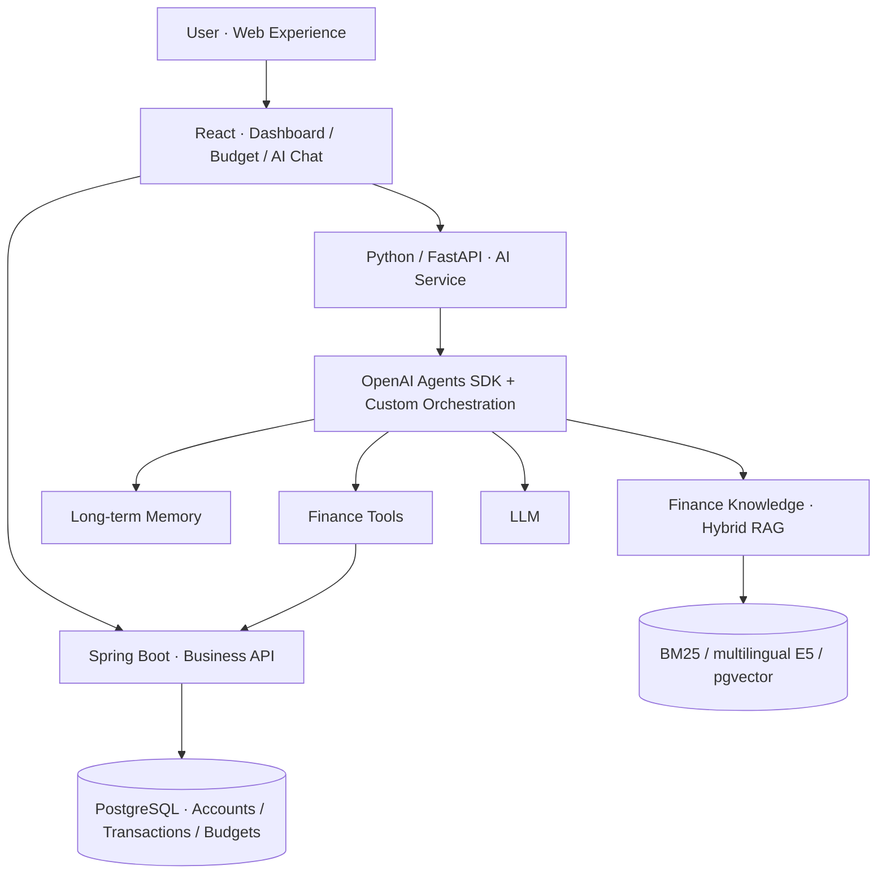

# 知省 WiseSpend

### 记账是起点，理解自己的消费才是答案。

**WiseSpend · AI-powered personal finance reflection**

> 你记得上个月花了多少钱吗？你知道为什么花了那么多吗？  
> 很多人认真记账，却从不回头看。分类、图表和流水越积越多，真正影响消费习惯的原因仍然藏在数字里。

WiseSpend 是一款围绕**消费复盘**设计的个人财务产品：将日常记账、可视化分析与具有上下文记忆的 AI 助手结合起来，让用户用聊天的方式理解账单、发现消费变化、回顾预算与目标。

它尤其适合不喜欢复杂预算表、很难坚持定期复盘的「P 人」：**不用先成为一个自律的财务管理者，也能开始了解自己的钱去了哪里。**

---

## 从记账到复盘

传统记账软件擅长告诉你「发生了什么」；WiseSpend 更希望帮你回答「这意味着什么」。

**一次自然的使用体验：**

> **你：** 我最近是不是点外卖太多了？  
> **WiseSpend：** 先看看近期外卖支出，再与上个周期对比。  
> **你：** 那上个月呢？  
> **WiseSpend：** 延续刚才关于外卖的讨论，切换时间范围。  
> **你：** 我之前说过想把外卖预算控制在多少吗？  
> **WiseSpend：** 结合已保存的长期目标与偏好，帮助你回顾原本的计划。

以上为**功能示意对话**，并非真实用户数据或实测回答截图。

### 让产品真正有用的四件事

- **看得清：** Dashboard、交易记录、分类与预算，让账本数据一目了然。
- **问得出：** 用自然语言查询支出、比较周期、理解消费变化，而非反复筛选报表。
- **接得住：** 支持多轮上下文和跨会话长期记忆，理解「那上个月呢」以及用户主动设定的消费目标。
- **想得明白：** 将财务知识与个人账本结合，为复盘提供背景与参考，而不是单纯制造焦虑或灌输自律。

**产品愿景：让每一次记账，都成为一次更轻松的自我了解。**

---

## Product Architecture

WiseSpend 不是在账本旁边简单添加一个聊天框，而是把 AI 能力接入真实的消费数据与现有业务系统。



**架构设计的重点：**

**业务与 AI 解耦。** Spring Boot 与 PostgreSQL 负责交易、预算和账户等可靠的数据管理；AI Service 负责理解问题、调用业务工具、组织上下文与生成解释。**LLM 不是账本事实来源。**

**会话上下文与长期记忆分开处理。** 产品既能延续当前话题，也能在合适的时候回顾用户明确表达并保存的偏好和目标。

**结构化查询与知识检索各司其职。** 消费金额与预算走业务 API / SQL；财务概念与参考知识走检索增强生成（RAG）。

---

## Agent Engineering

**Base:** [OpenAI Agents SDK — Python](https://openai.github.io/openai-agents-python/)  
**Approach:** SDK primitives + purpose-built orchestration

我选择在成熟 SDK 之上保留定制化的 Python Agent Orchestration，而不是把所有业务判断交给一个黑盒流程。

- **复用成熟能力：** Tool Calling 与 Tracing 等基础设施由 SDK 提供。
- **保留产品控制权：** 业务工具边界、会话状态、数据校验与异常处理可以按财务场景定制。
- **便于产品演进：** 记账业务可以独立于模型或 Agent 层迭代，不必将每个功能绑定到特定提示词或模型。

这并非为了「从零重写一个框架」，而是**不重复造基础轮子，同时把重要的业务行为掌握在自己手中**。

官方参考：[Agents SDK Documentation](https://developers.openai.com/api/docs/guides/agents/sdk) · [Tracing Documentation](https://openai.github.io/openai-agents-python/tracing/)

---

## Long-term Memory & Knowledge

### 有记忆的财务对话

WiseSpend 能够结合当前会话与已保存的长期用户偏好，让消费对话不止停留在一次性问答。预算目标、消费偏好和多轮话题形成持续的复盘体验。

### Hybrid RAG

财务知识模块组合关键词与语义检索，兼顾专业术语匹配和自然语言理解：

```text
Finance knowledge → Chunking → BM25 + multilingual E5 / pgvector
                                    ↓
                              RRF ranking
                                    ↓
                          Relevant evidence → Answer
```

**Research & implementation references**

- [Multilingual E5 Text Embeddings: A Technical Report (2024)](https://arxiv.org/abs/2402.05672) — 多语言语义向量检索。
- [Reciprocal Rank Fusion (SIGIR 2009)](https://doi.org/10.1145/1571941.1572114) — 融合不同检索结果排序的方法。
- [OpenAI Agents SDK](https://openai.github.io/openai-agents-python/) — Agent、Tools 与 Tracing 的官方实现参考。

这些文献与文档是相关技术方案的参考依据，并不代表论文作者参与了本项目。

---

## Tech Stack

| Layer | Technology |
| --- | --- |
| Product UI | React · JavaScript / TypeScript |
| Business Services | Java · Spring Boot |
| AI Service | Python · FastAPI · OpenAI Agents SDK |
| Data & Memory | PostgreSQL · Redis |
| Knowledge Retrieval | BM25 · multilingual E5 · pgvector · RRF |
| Infrastructure | Docker · Git |

---

## Built as a Product

WiseSpend 从个人记账 Web 应用延伸而来，由我独立负责产品方向、体验设计、AI Agent 架构与全栈实现。

我希望它不只是一个展示 AI 技术的 Demo，而是一款有明确使用场景的产品：**让不擅长定期复盘的人，也能借助 AI 建立对个人消费的理解。**

目前该仓库为公开 **Product Case Study**，用于展示产品定位与技术架构；完整业务源码不公开。

> **WiseSpend — Don't just track your money. Understand it.**
